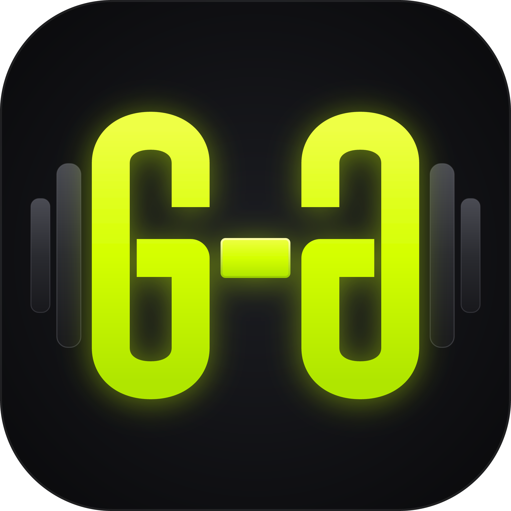

<p align="center">
  
</p>

<h1 align="center">GGym</h1>

<p align="center">
  A workout tracker for Android that runs entirely on your phone.
</p>

---

**GGym** keeps track of the weight you actually lift on each exercise, runs your rest timer even
when the app is closed or the screen is locked, and shows what you have been doing over time in a
calendar and a handful of charts. No account, no sync, no internet connection — the app never asks
for the `INTERNET` permission, so "your data stays on your device" is a property of the build
rather than a promise in a policy document.

**[Download the latest signed APK →](https://github.com/luigiMiranda/ggym/releases/latest)**

## Status

v1 is feature-complete and shipped:

- ✅ Project scaffold: single-module Kotlin/Compose app, Room + DataStore
- ✅ Brand theme: Material 3 **Expressive** (`MaterialExpressiveTheme`, `MotionScheme.expressive()`),
  light / dark / system, optional wallpaper colours (off by default)
- ✅ Four-tab shell: Workouts · Calendar · Stats · Settings
- ✅ App icon: adaptive + monochrome, transcribed from `artwork/ggym.svg`
- ✅ Routine management: routines, training days, exercises, an auto-completing dictionary, a
  working weight per routine slot that remembers what you actually lifted, and drag-to-reorder
- ✅ Active workout: overview and a swipeable focused view with the working weight as the hero,
  set completion and un-completion, add/remove sets, rename an exercise, finish/discard, and a
  draft that survives a process death
- ✅ Background rest timer: foreground service, a notification with ±15 s / skip, an exact-alarm
  backstop, and an alert that ducks your music instead of stopping it — with a chosen alert sound
  and a ring policy (automatic after N seconds, or until stopped)
- ✅ History: a monthly calendar with a dot per workout, day inspection, edit and delete
- ✅ Stats: body-weight log and trend, workout attendance, and per-exercise progression charts
  (drawn on a custom `Canvas`, no charting dependency)
- ✅ Localized in **English and Italian**, with an in-app language switch (or follow the system)
- ✅ 527 JVM/Robolectric tests and a clean lint run (`./gradlew :app:testDebugUnitTest :app:lintDebug`)

Not yet in v1:

- ⬜ JSON backup export/import UI — the format and the manager exist
  (`data/backup/BackupManager`), but the Settings rows that reach them are still to come. Until
  then "your data stays on your device" also means it does not leave it.

## Design principles

- **Offline by construction.** No network permission, no analytics, no crash reporting, no ads.
  Auto Backup and device-to-device transfer are switched off as well.
- **The current weight is the point.** Every exercise remembers the weight you last worked with,
  so when you open a routine you immediately know what to load on the bar.
- **Weight first, everything else second.** On the workout screen the weight is the largest,
  most prominent control; reps and rest follow.
- **You own the data.** Everything lives in an on-device SQLite database; the backup format is
  plain, human-readable JSON, so a backup you export is a file you can read, diff and keep.
- **Expressive but not silly.** Spring motion and shape changes carry meaning (a set is done, a
  swipe moved you between exercises) rather than decorating the screen.

## Building

Requirements: JDK 17 or newer (21 tested), Android SDK with platform 37 and build-tools 36.

```bash
./gradlew :app:assembleDebug        # debug APK -> app/build/outputs/apk/debug/
./gradlew :app:assembleRelease      # R8-shrunk, signed release APK -> app/build/outputs/apk/release/
./gradlew :app:testDebugUnitTest    # JVM unit tests
./gradlew :app:lintDebug            # Android lint
```

The release build is signed from a keystore that is intentionally **not** in this repository: it
reads `keystore.properties` at the repo root (git-ignored) and fails loudly if the file is missing,
rather than producing an unsigned APK. Without your own keystore, use the debug build.

On a machine without an Android SDK yet, `scripts/bootstrap-toolchain.sh` installs a local JDK 21,
the Android command-line tools and the required SDK packages under `$HOME` — no root access needed —
and `scripts/env.sh` exports the environment for the current shell.

The app declares `minSdk 26` and `targetSdk 37`, and requests no network permission. The
notification permission is asked once, when the rest timer is first needed.

## Technology

| | |
|---|---|
| Language | Kotlin, coroutines + Flow |
| UI | Jetpack Compose, Material 3 Expressive |
| Architecture | single `:app` module, package-by-feature, MVVM with unidirectional data flow, manual dependency injection |
| Persistence | Room (SQLite) + DataStore |
| Background work | foreground service + notifications (for the rest timer) |
| Build | Gradle with a version catalog; AGP 9 with built-in Kotlin |

## Project layout

```
app/src/main/kotlin/com/ggym/app/
├── data/          persistence: Room entities and DAOs, DataStore preferences, backup
├── domain/        models and the rules that carry real logic
├── service/       the rest-timer foreground service and its notifications
├── di/            the app's manual dependency container
└── ui/            theme, navigation, and one package per feature screen
artwork/           brand source of truth: the icon as SVG, plus the original raster
docs/              ARCHITECTURE.md — how the pieces fit together and why
scripts/           local toolchain bootstrap
```

## Documentation

- [`docs/ARCHITECTURE.md`](docs/ARCHITECTURE.md) — layering rules, state conventions, the data
  model, the backup format, and the reasoning behind the pinned library versions.

## License

Licensed under the [Apache License 2.0](LICENSE). See [`NOTICE`](NOTICE) for attribution.

The GGym name and the icon in `artwork/` are part of the project's identity; the license covers
the source code and the artwork alike.
